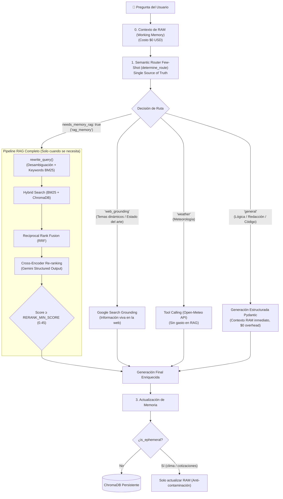

# 🤖 LLM CLI — Gemini Modular con Semantic Router, Grounding y Zero-Waste RAG

CLI profesional de ingeniería de IA para interactuar con la API oficial de **Google Gemini (`google-genai`)**, validado con **Pydantic**, con soporte para **imágenes/audio**, **Google Search Grounding en vivo**, **consulta de clima en tiempo real (Tool Calling)**, **Semantic Routing Few-Shot** y **Advanced RAG con Gatekeeper de Costo Cero (Zero-Waste RAG)**.

---

## 🎯 Arquitectura de Enrutamiento Inteligente (Zero-Waste RAG)

A diferencia de los sistemas RAG ingenuos que ejecutan reescrituras de consultas y búsquedas vectoriales a ciegas para cada frase, este sistema implementa un **Semantic Router Few-Shot** como guardián de entrada.

El router clasifica la intención considerando el **contexto activo de la conversación (Working Memory)** y solo dispara el pipeline costoso si realmente se requiere recuperar información histórica de ChromaDB:



---

### 🚦 Las 4 Rutas Semánticas Universales

El Router no utiliza listas frágiles de palabras clave estáticas, sino comprensión contextual multitemática mediante Few-Shot Learning:

| Ruta | Cuándo se activa | Comportamiento | Overhead RAG |
| :--- | :--- | :--- | :--- |
| **`web_grounding`** | Temas dinámicos, novedades, tendencias, estado del arte o roadmaps técnicos en constante evolución (*"roadmap de AI Engineer"*, *"mejores frameworks web en 2025/2026"*). | Consulta Google Search en tiempo real y extrae fuentes verificadas. | **0 tokens ($0.00)** |
| **`weather`** | Consultas meteorológicas de cualquier ciudad o región (*"clima en Madrid hoy"*). | Llama a la herramienta de Open-Meteo vía Tool Calling. | **0 tokens ($0.00)** |
| **`rag_memory`** | Peticiones explícitas de recuperar notas, acuerdos o recuerdos archivados en sesiones anteriores (*"¿recuerdas qué receta me guardaste la semana pasada?"*). | Dispara el pipeline completo: `rewrite_query` $\rightarrow$ Hybrid Search $\rightarrow$ RRF $\rightarrow$ Re-ranking. | Tokens medidos |
| **`general`** | Conceptos atemporales, matemáticas, lógica, explicaciones teóricas, redacción o código estándar (*"qué es un decorador en Python"*, *"cómo funciona la fotosíntesis"*). | Responde directamente con el contexto inmediato de la Working Memory. | **0 tokens ($0.00)** |

---

### 🔬 Componentes del Pipeline RAG

Cuando una consulta requiere memoria histórica (`rag_memory`), se activan los tres eslabones:

1. **Query Engineering (`rewrite_query`)**:
   - Resuelve pronombres (*"¿cuándo llegó él?"* $\rightarrow$ *"¿cuándo llegó Lionel Messi?"*) y extrae palabras clave para el motor léxico.
2. **Hybrid Search (BM25 + Vectorial) con RRF**:
   - Búsqueda léxica precisa con `rank_bm25` (BM25Okapi).
   - Búsqueda semántica densa con `gemini-embedding-2` en ChromaDB.
   - Fusión mediante Reciprocal Rank Fusion:
     $$RRF\_Score(d) = \sum_{m \in M} \frac{1}{60 + r_m(d)}$$
3. **Cross-Encoder Re-ranking (`rerank_documents`)**:
   - Emplea `gemini-2.5-flash-lite` con Structured Output para evaluar la relevancia exacta de cada fragmento.
   - Parámetros centralizados en `config.py`: `RERANK_MIN_SCORE = 0.45` y `RERANK_TOP_N = 2`.

---

## 📁 Arquitectura Modular del Proyecto

```
llm-cli/
├── config.py           ← Configuración global (.env), umbrales RERANK_MIN_SCORE y tabla de tarifas
├── models.py           ← Esquemas Pydantic (RouteDecision semántico, LLMResponse, CallMetrics)
├── tools.py            ← Herramientas ejecutables (Clima en tiempo real con Open-Meteo)
├── rag.py              ← Advanced RAG (rewrite_query, BM25, RRF y Cross-Encoder Reranking)
├── memory.py           ← Memoria híbrida (RAM Working Memory + Episodic Memory en ChromaDB)
├── client.py           ← Lógica con Google GenAI SDK (Semantic Router Few-Shot, Grounding, Failover)
├── display.py          ← Renderizado de UI en consola con Rich y persistencia en JSONL
├── llm_cli.py          ← Punto de entrada principal y bucle interactivo optimizado
├── .env                ← Variables de entorno (GEMINI_API_KEY, GEMINI_MODEL)
├── requirements.txt    ← Dependencias necesarias
└── chroma_db/          ← Base de datos vectorial persistente con embeddings
```

---

## 🚀 Instalación y Uso

```bash
cd llm-cli
pip install -r requirements.txt
```

### Modos de Ejecución

```bash
# Modo interactivo continuo con Working Memory y Semantic Routing:
python llm_cli.py

# Preguntas directas (-q):
# 1. Detecta automáticamente que requiere estado del arte y activa Google Grounding:
python llm_cli.py -q "me armas un roadmap de AI engineer"

# 2. Detecta que es un concepto atemporal y responde directo (0 tokens de overhead RAG):
python llm_cli.py -q "¿Qué es un decorador en Python?"

# 3. Detecta consulta meteorológica y ejecuta la tool de clima:
python llm_cli.py -q "¿Qué temperatura hace en Buenos Aires ahorita?"

# Consultar historial y estadísticas acumuladas:
python llm_cli.py --history
python llm_cli.py --stats
python llm_cli.py --modelos
```

---

## 💰 Medición Precisa del ROI en Tokens

Cada llamada registra en [`logs/history.jsonl`](file:///c:/Users/victor/Downloads/aiengineer/logs/history.jsonl):
- Si la llamada es directa o web: el overhead de RAG es **0 tokens ($0.00000000 USD)**.
- Si la llamada activa memoria episódica: desglosa los tokens de Query Engineering y Re-ranking por separado en la tabla Rich.
