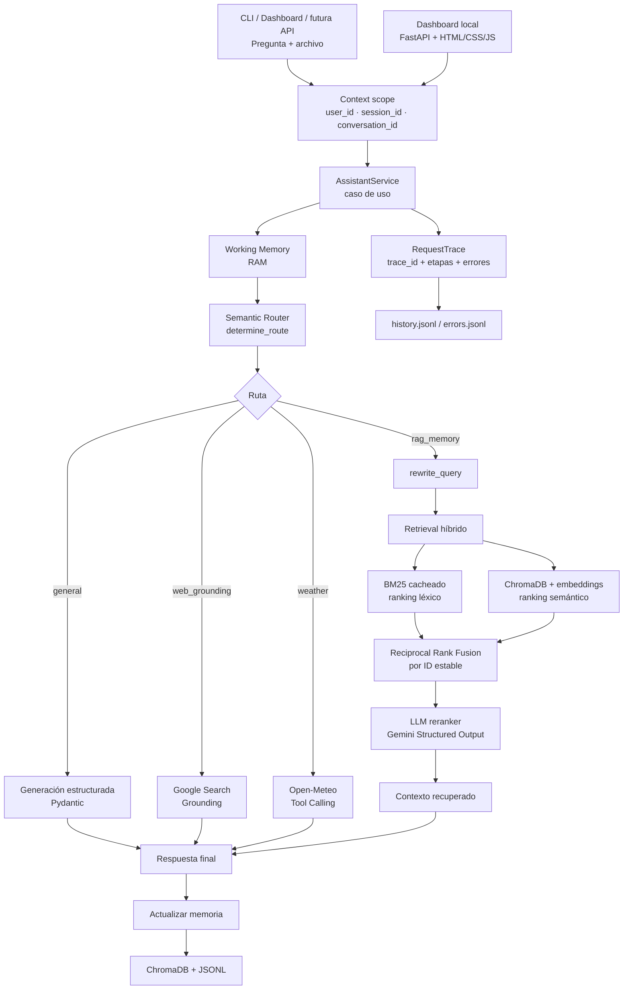
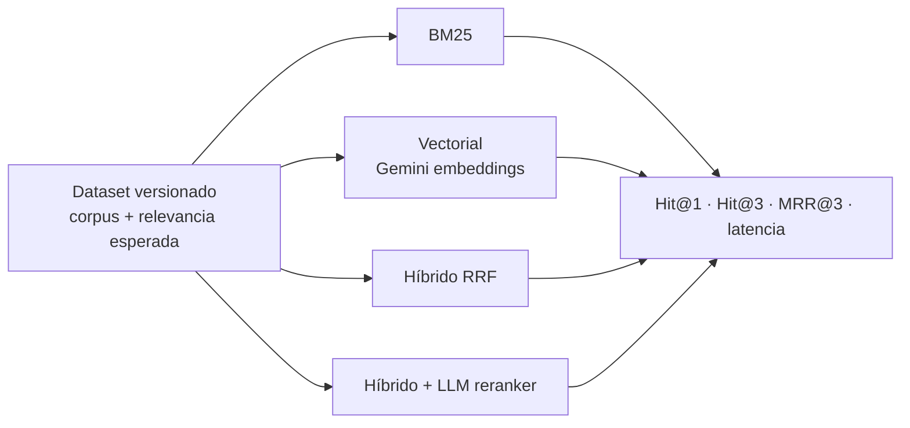

# Arquitectura

## Flujo de una consulta

## Decisiones importantes

- BM25 se construye una vez y se invalida cuando crece la colección de ChromaDB.
- BM25, vector search y RRF usan IDs estables; el texto se recupera después para evitar colisiones entre documentos iguales.
- El reranking se ejecuta solo sobre pocos candidatos y usa Gemini como LLM reranker. No se carga un cross-encoder local para mantener bajo el consumo de RAM.
- Las consultas que no necesitan memoria no ejecutan el pipeline RAG.
- `llm_cli.py` no contiene la lógica del caso de uso: solo convierte argumentos/input en `AskRequest` y presenta `AskResult`.
- Los errores se clasifican como configuración, proveedor, cuota, modelo no disponible, retrieval, memoria o tool execution.
- Cada solicitud produce un `trace_id` y registra latencia por etapa sin persistir secretos completos.
- La medición de tokens cubre router, query rewriting, reranker, generación y memory update; embeddings registran cantidad de llamadas y tokens si el SDK los expone.
- `user_id`, `conversation_id` y `session_id` viajan desde `AskRequest` hasta métricas, errores y memoria persistente.
- ChromaDB filtra por `user_id + conversation_id`; `session_id` no participa en el filtro episódico para permitir reanudar el mismo chat en otra ejecución.
- La Working Memory se guarda en un registro del servicio indexado por los tres IDs, evitando que dos chats activos compartan sujeto o hechos recientes.
- Los documentos legacy sin IDs reciben el scope local por defecto mediante una migración idempotente al iniciar la memoria.

## Evaluación

El benchmark versionado en `benchmarks/` compara BM25, búsqueda vectorial, híbrido RRF y el híbrido con LLM reranker usando Hit@1, Hit@3, MRR@3 y latencia.

