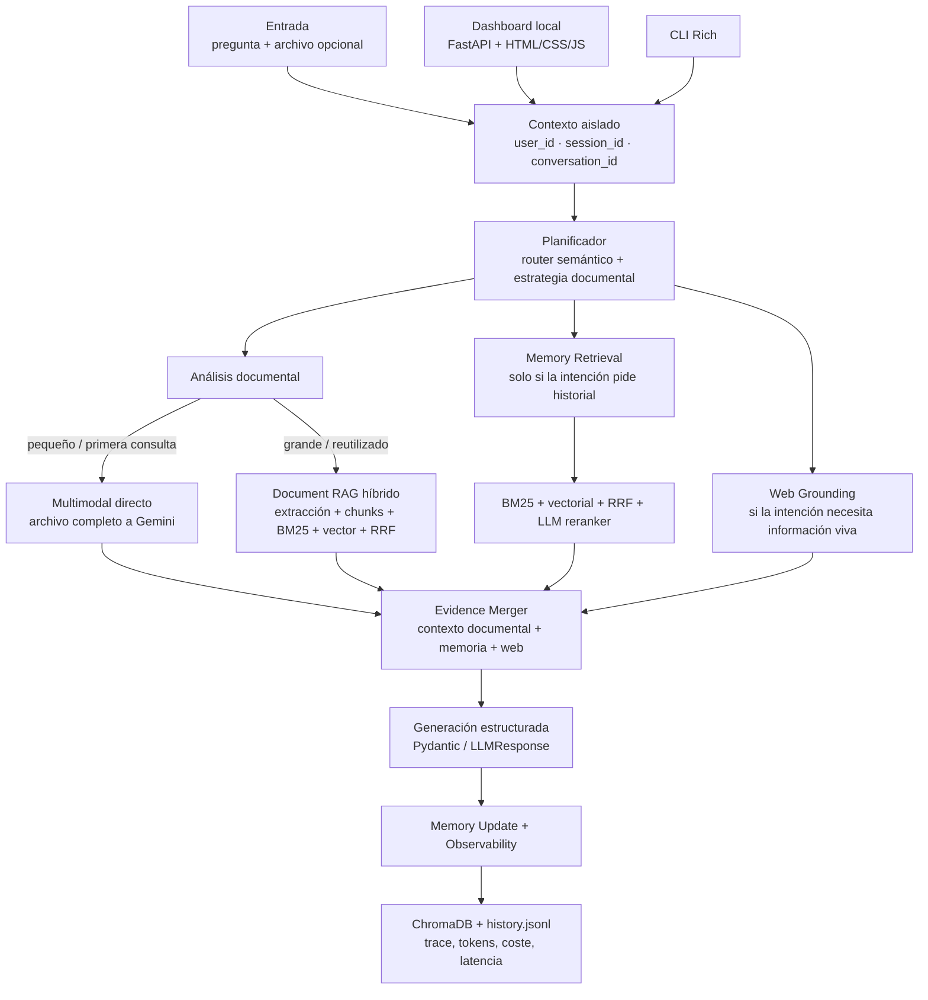
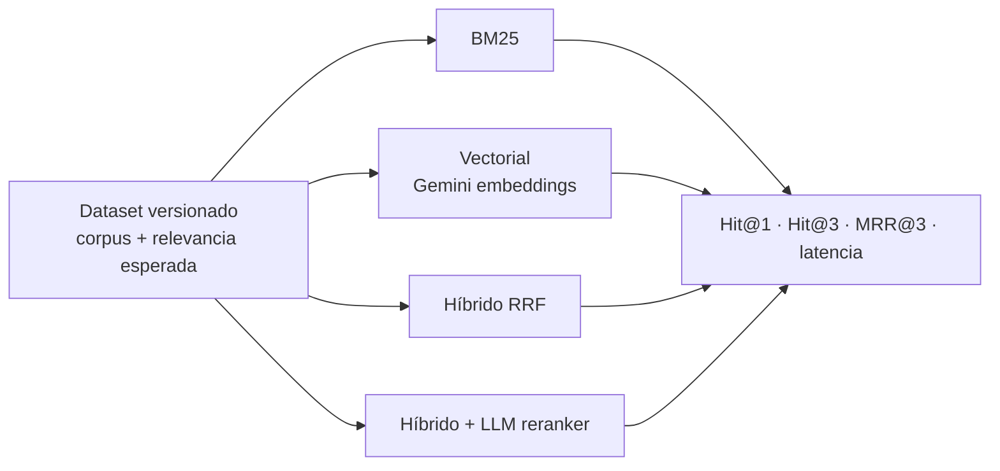

# Arquitectura

## Flujo principal

El proyecto mantiene `AssistantService` como fuente de verdad para la CLI y el
dashboard. El planificador combina dos decisiones: el router semántico para la
intención de la pregunta y una estrategia determinista para el archivo
adjunto. No se usan palabras clave como mecanismo principal de routing.



## Estrategia documental

La estrategia se decide en `document_rag.py` y queda registrada en
`RouteDecision.document_mode` y `RouteDecision.document_reason`.

| Situación | Estrategia | Comportamiento |
| :--- | :--- | :--- |
| Documento pequeño, extraíble o multimodal, y primeras consultas | `multimodal_direct` | Se envía el archivo completo al modelo, conservando el análisis nativo de Gemini. |
| Documento mayor de 2 MB | `document_rag` | Se copia a caché local y se encola la extracción, el chunking y los embeddings; la primera respuesta no espera al worker. |
| Consulta posterior del mismo documento | `document_rag` | En cuanto el índice está `ready`, se reutiliza con BM25 + vector search + RRF; si sigue pendiente, se mantiene el camino directo. |
| Imagen o audio | `multimodal_direct` | No se fuerza una extracción textual pobre; se conserva el análisis multimodal. |

Los formatos con extracción local son TXT, CSV, TSV, XLSX, PDF y DOCX. Los
archivos XLS antiguos deben convertirse a XLSX o CSV para activar Document RAG.
El registro de consultas guarda el hash del archivo, el usuario y el contador.
Para permitir indexación después de cerrar la petición HTTP, los formatos
extraíbles se conservan en `logs/document_cache/`; la copia temporal del upload
se elimina al terminar la solicitud.

## Chunking y retrieval documental

El chunking documental es estructural con fallback de ventana fija:

- PDF: una sección por página.
- XLSX/CSV/TSV: secciones por hoja o grupos de filas.
- DOCX: grupos de párrafos y tablas.
- TXT: párrafos separados por líneas vacías.
- Texto sin estructura: ventanas de 1.800 caracteres con overlap de 250.

Cada chunk conserva un `source_id` y un `locator` para poder identificar la
hoja, página, tabla, filas o fragmento que llegó al generador.

La recuperación documental combina dos rankings:

```text
BM25 + búsqueda vectorial
          ↓
        RRF
          ↓
  candidatos documentales
          ↓
LLM reranker condicional
```

El reranker se activa cuando los primeros resultados de BM25 y del buscador
vectorial discrepan, tanto en Document RAG como en la memoria episódica. Las
consultas con resultados claramente alineados usan RRF directamente para no
añadir una llamada innecesaria al proveedor.

La indexación documental es asíncrona. `DocumentRAG` mantiene un worker local
con estados `queued`, `running`, `ready` y `failed`; los embeddings de un
documento se solicitan en lotes. Mientras el índice no está listo, el servicio
usa análisis multimodal directo y no bloquea la respuesta esperando la
indexación.

## Decisiones de arquitectura

- `AssistantService` sigue siendo la única fuente de verdad. El dashboard y la
  CLI son adaptadores de entrada/salida.
- El routing de intención es semántico. La heurística de palabras clave solo
  existe como fallback cuando el proveedor no responde.
- Document RAG es una capacidad acotada del pipeline actual, no un agente nuevo:
  extrae, fragmenta, indexa, combina BM25 con búsqueda vectorial mediante RRF y
  puede re-rankear candidatos; después entrega el contexto al mismo generador
  estructurado.
- Los chunks documentales viven en la colección ChromaDB `document_chunks`,
  separada de `episodic_memory`. `index_version=2` evita mezclar índices
  creados con el chunking fijo anterior.
- La recuperación documental se aísla por `user_id + conversation_id +
  document_id`; así un usuario no recibe chunks de otro contexto.
- Si la extracción o el retrieval documental falla, el flujo conserva un
  fallback observable al análisis multimodal directo.
- Los archivos pequeños priorizan simplicidad y latencia. Los documentos
  grandes o reutilizados priorizan coste de contexto y recuperación precisa.
- BM25, vector search y RRF son el camino normal. El LLM reranker solo se
  ejecuta cuando BM25 y la búsqueda vectorial discrepan en sus candidatos
  principales.
- La primera consulta de un archivo extraíble no espera la indexación: el
  documento se conserva en caché local y el worker construye el índice en
  segundo plano. El trace expone `indexing_status` para distinguir
  `queued/running/ready/failed`.
- El dashboard no permite editar IDs manualmente. El usuario activo se elige
  desde una lista local y “Nuevo usuario” crea una identidad aislada; la
  conversación y la sesión se generan automáticamente.
- La memoria episódica se filtra por `user_id + conversation_id`. El
  `session_id` se conserva para trazabilidad y para separar la Working Memory.
- Cada solicitud produce un `trace_id` con etapas, errores sanitizados,
  fallbacks, tokens, coste y latencia.
- No se añade LangGraph en esta entrega. La orquestación sigue siendo síncrona
  y explícita; solo la indexación documental se ejecuta en un worker de fondo
  para no bloquear la respuesta.

## Evaluación del retrieval

El benchmark versionado en `benchmarks/` compara BM25, búsqueda vectorial,
híbrido RRF y el híbrido con LLM reranker usando Hit@1, Hit@3, MRR@3 y
latencia.



## Observabilidad

Las etapas principales son `route`, `document_analysis`, `query_rewrite`,
`retrieval`, `working_memory`, `generation` y `memory_update`. La etapa
`document_analysis` expone si se usó multimodal directo o Document RAG, el hash
del documento, su tamaño, las consultas previas, los chunks recuperados, los
candidatos BM25/vectoriales, el modo RRF y si se usó reranker.

Los logs persistentes son:

- `logs/history.jsonl`: ejecuciones correctas con payload, trace y métricas.
- `logs/errors.jsonl`: errores clasificados y sanitizados.
- `logs/document_registry.json`: contador local por usuario y hash documental.

El dashboard muestra estos datos en Output, Trace, Payload e History. Los
archivos subidos se almacenan temporalmente durante la solicitud y se eliminan
al terminar; los documentos extraíbles tienen una copia local en
`logs/document_cache/` para completar la indexación asíncrona.
